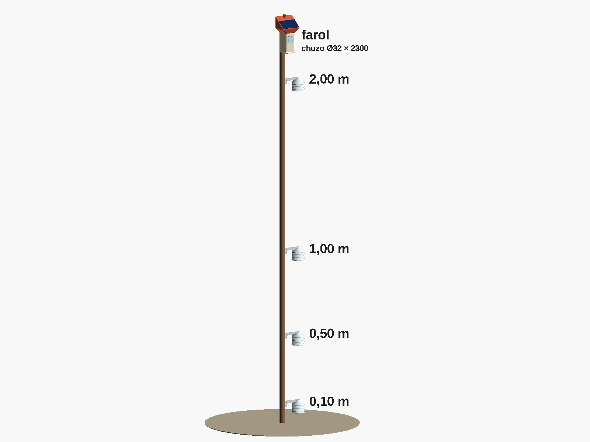
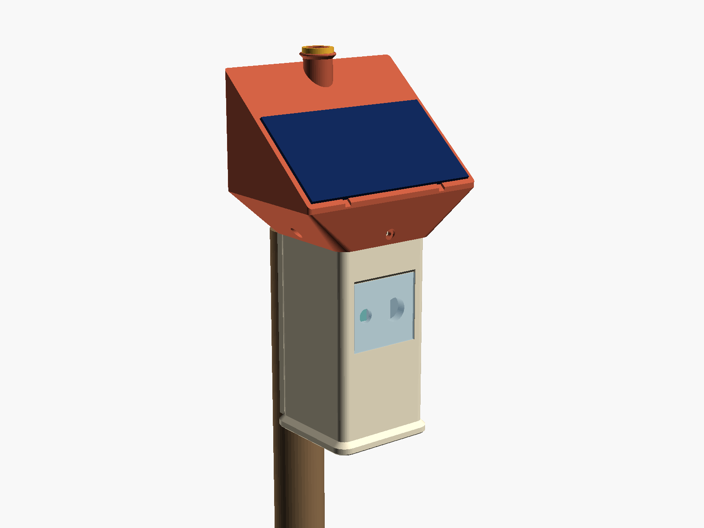

# Sereno · piezas imprimibles

Modelo paramétrico en OpenSCAD (`sereno.scad`) de las piezas de plástico del
chuzo de Sereno. El chuzo en sí (poste o palo de Ø25–50 mm, unos 2,3 m sobre el
suelo) no se imprime.

> **Nada de esto se ha impreso todavía.** Las medidas salen de hojas de datos y
> de suposiciones; antes de imprimir, comprueba cada componente con el calibre.
>
> **La envolvente de la placa está SIN VERIFICAR.** `placa_largo = 112`,
> `placa_ancho = 38`, `placa_grosor = 26`, `pcb_grosor = 1.6` y
> `pcb_a_trasera = 21` (LilyGO T-SIM7080G-S3 con portapilas 18650) son valores
> supuestos: **mide tu placa** y corrígelos al principio de `sereno.scad` antes
> de imprimir el cuerpo. Los carriles sujetan la PCB por sus dos cantos largos y
> pisan 2 mm de cada cara: comprueba que ahí no hay componentes.




Más vistas en `docs/img/`: `despiece.png`, `cabeza_corte.png`, `pagoda.png`,
`pagoda_corte.png`.

## Piezas

| Pieza (`pieza=`) | Qué es | Cant. | Orientación de impresión | Tamaño (mm) |
|---|---|---|---|---|
| `farol_cuerpo` | Cuerpo del farol: aloja la placa en vertical sobre dos carriles, ventana frontal con cámara y LED, prensaestopas abajo y silla en V detrás | 1 | De pie, boca arriba (el suelo sobre la cama) | 66 × 78,7 × 130 |
| `farol_tejado` | Tejado a un agua (40°) con rebaje para el panel solar, chimenea del sensor de cielo y faldón que abraza el cuerpo | 1 | Tal cual, el faldón sobre la cama | 117 × 78 × 102,8 |
| `anillo_cielo` | Anillo que tensa el film de polietileno sobre la boca de la chimenea | 1 | Plano; se monta con el chaflán hacia abajo | Ø18,1 × 3 |
| `pagoda` | Abrigo antirradiación de una sonda: tapa cónica, 5 lamas a 45°, jaula central, brazo y silla en V | 4 | **Invertida**: la tapa sobre la cama, el collarín arriba | 140,5 × 76 × 76,7 |

Los STL de `../stl/` ya están en su orientación de impresión, apoyados en z = 0.

## Impresión

- **Material:** ASA (mejor a la intemperie) o PETG. Pagodas en **blanco**; el
  farol en color claro para que no se caliente.
- **Boquilla** 0,4 mm · **altura de capa** 0,2 mm · 3 perímetros · relleno
  15–20 % (la silla del cuerpo y la losa del tejado son macizas en el modelo).
- **Soportes: ninguno.** Todos los voladizos son de 45° o menos; solo quedan
  puentes cortos (pasos de brida de 3,5 mm y 2 mm) y taladros horizontales
  redondos (el mayor, el del LED, Ø14).
- Borde (*brim*) recomendable en la pagoda: apoya solo en la tapa (Ø20), el
  brazo y la silla.
- Holgura de ajuste entre piezas: `holgura = 0.3`.

## Qué más hace falta

- 4 tornillos **M3 × 8** de cabeza cilíndrica o alomada (cabeza ≤ Ø6): unen
  tejado y cuerpo roscando en los pilotos de Ø2,5.
- 2 tornillos **M3 × 6**: sujetan la PCB estrella (20 mm) del LED a su asiento.
- **Cristal** de metacrilato transparente de **43,4 × 39,4 × 1,5 mm**, pegado
  en el rebaje de la ventana con silicona neutra (rellena con ella la cuña del
  dintel).
- **Film de polietileno** fino (bolsa de congelación), un disco de unos 30 mm,
  para la ventana del MLX90614.
- Prensaestopas **PG7** con su tuerca.
- Farol al chuzo: 2 abrazaderas sinfín de banda de 8 mm, o bridas de hasta
  8 mm de ancho (pasos de 9 × 3,5).
- Cada pagoda al chuzo: 2 bridas de hasta 4 mm (ranuras de 4,5 × 2), más una
  brida fina de 2,5 mm para cerrar el collarín sobre la sonda.
- Silicona neutra o cinta de doble cara de exterior para el panel solar
  (110 × 60 × 3) y para sellar su cable.

## Montaje

1. **Cuerpo.** Atornilla la estrella del LED en su asiento y encaja la cámara
   en su cuna. Pasa el mazo de sondas por el PG7. La placa baja de canto por los
   carriles hasta el tope, que deja 8 mm libres debajo para cables.
2. **Chimenea.** La cápsula TO-39 del MLX90614 entra desde dentro del tejado
   hasta hacer tope en el labio; fíjala con una gota de silicona. Por fuera,
   tiende el film sobre la boca y cálalo con el anillo.
3. **Tejado.** Pega el panel en su rebaje con el cable por el taladro de Ø5.
   El tejado encaja en **cuatro orientaciones** (pilotos en patrón cuadrado, uno
   por cara): la cámara mira a lo largo de la fila y el panel al sur. Los
   tornillos entran de lado, bajo el alero, así que el tejado se desmonta sin
   tocar el panel.
4. **Al chuzo.** La silla en V admite poste redondo o cuadrado. El extremo del
   chuzo debe quedar unos milímetros por debajo del tope de la silla para no
   tropezar con el tejado.
5. **Pagodas.** La sonda DS18B20 (Ø6 × 50) entra por abajo y se aprieta con la
   brida del collarín. Una plaquita SHT4x de 13 × 13 entra de canto por la
   ranura, se gira un cuarto de vuelta y queda apoyada en el embudo. Alturas de
   referencia (centro de la jaula): 0,10 · 0,50 · 1,00 · 2,00 m.

## Regenerar

```sh
openscad -o ../stl/pagoda.stl -D 'pieza="pagoda"' sereno.scad   # una pieza
python3 generar.py                                              # todo: STL, comprobación e imágenes
```

`generar.py` exporta los cuatro STL, comprueba que cada uno es un único sólido
cerrado, imprime su caja envolvente y dibuja las imágenes de `docs/img/` con
OpenSCAD (usa `xvfb-run` si no hay pantalla; necesita numpy y Pillow).

## Pendiente de comprobar

- Envolvente y canto libre de la placa (ver aviso de arriba).
- Módulo de cámara: la cuna supone un cuerpo de 8,6 mm de lado (`cam_modulo`);
  si no coincide, pon `cam_cuna = false`.
- Paso entre tornillos de la estrella del LED (`led_torn_sep = 19`).
- Ajuste del anillo con tu film (`anillo_holg = 0.15`).
- El LED va sobre plástico: vale para destellos cortos, no para luz continua.
- Si tu impresora aguanta voladizos de 50°, `techo_int_ang = 40` deja la losa
  del tejado uniforme y ahorra un tercio de su volumen.
